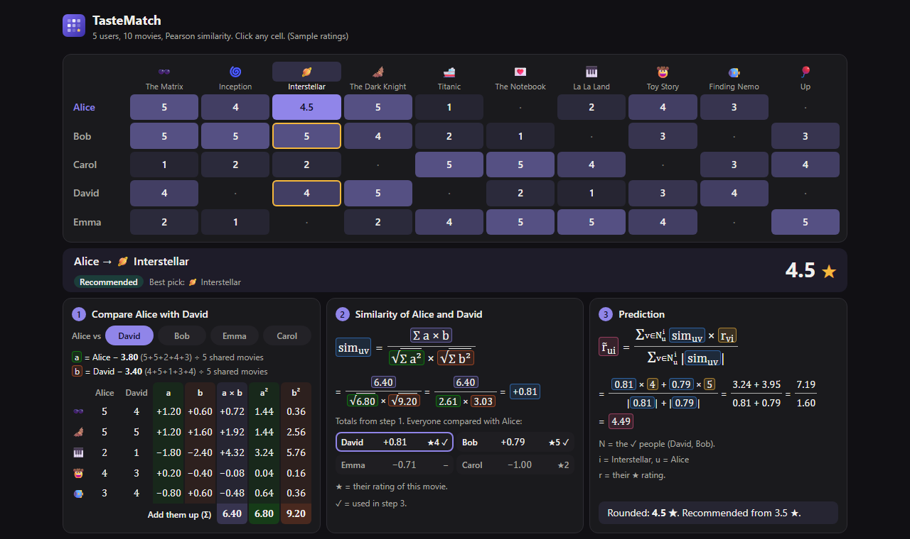

# TasteMatch

**See exactly how a recommender system predicts a rating.**

TasteMatch is a one-screen web app built for a university assignment. Five users have rated ten movies. Click any cell and it predicts that rating with Pearson similarity, showing every number from the raw ratings to the final answer.



## How to use it

1. **Click a cell** in the table to choose a user and a movie.
2. **Read the answer bar** for the predicted rating and the best pick for that user.
3. **Follow the three steps** below it to see where the number came from. Pick a different person in step 1 to see their comparison.

On smaller screens, the three steps sit behind tabs.

If the cell already has a rating, the app hides it and predicts it anyway, so you can compare the guess with the real rating.

## How the prediction works

The app uses user-based collaborative filtering: to guess what user $u$ thinks of movie $i$, it looks at how people with similar taste rated that movie.

**Pearson similarity** measures how alike two users' tastes are, from −1 (opposite) to +1 (the same). It only uses the movies both of them rated:

$$
sim_{uv} = \frac{\sum a \times b}{\sqrt{\sum a^2} \times \sqrt{\sum b^2}}
$$

Here $a$ is user $u$'s rating minus their average, and $b$ is the same for user $v$. Both averages are taken over the shared movies.

**The prediction** is an average of the neighbours' ratings, where closer taste counts for more:

$$
\tilde{r}_{ui} = \frac{\sum_{v \in N_u^i} sim_{uv} \times r_{vi}}{\sum_{v \in N_u^i} |sim_{uv}|}
$$

$N_u^i$ is the set of neighbours: users similar to $u$ who rated movie $i$.

### Worked example: Alice and Interstellar

Alice hasn't rated Interstellar. To compare her with David, the app takes the 5 movies they both rated:

| Movie | Alice | David | a | b | a × b | a² | b² |
|---|---:|---:|---:|---:|---:|---:|---:|
| The Matrix | 5 | 4 | +1.20 | +0.60 | +0.72 | 1.44 | 0.36 |
| The Dark Knight | 5 | 5 | +1.20 | +1.60 | +1.92 | 1.44 | 2.56 |
| La La Land | 2 | 1 | −1.80 | −2.40 | +4.32 | 3.24 | 5.76 |
| Toy Story | 4 | 3 | +0.20 | −0.40 | −0.08 | 0.04 | 0.16 |
| Finding Nemo | 3 | 4 | −0.80 | +0.60 | −0.48 | 0.64 | 0.36 |
| **Total** | | | | | **6.40** | **6.80** | **9.20** |

Alice's average on these movies is 19 ÷ 5 = 3.80, and David's is 17 ÷ 5 = 3.40.

**Similarity:** 6.40 ÷ (√6.80 × √9.20) = 6.40 ÷ (2.61 × 3.03) = **+0.81**

Comparing Alice with everyone else the same way gives:

| Person | Similarity | Rating of Interstellar | Neighbour? |
|---|---:|---:|---|
| David | +0.81 | 4 | Yes |
| Bob | +0.79 | 5 | Yes |
| Emma | −0.71 | not rated | No |
| Carol | −1.00 | 2 | No: opposite taste |

**Prediction:** (0.81 × 4 + 0.79 × 5) ÷ (|0.81| + |0.79|) = 7.19 ÷ 1.60 = **4.49**, shown as 4.5 ★

## Design choices

The assignment's formula doesn't settle these points, so the app makes these choices:

- **Who counts as a neighbour:** users with a positive similarity who rated the movie.
- **No neighbours:** the formula has nothing to add up, so the app shows the user's own average and says so.
- **Rounding:** similarity is rounded to 2 decimals before it's used, so the prediction can be checked by hand. Other values are shown to 2 decimals, so a hand calculation can differ in the last digit.
- **Recommended:** a predicted rating of 3.5 ★ or more counts as recommended. This cut-off is a rule chosen for this demo, not a calculated value. It's `RECOMMEND_FROM` in `recommenderService.ts`.
- **Sample data:** the movies are real, but the users and ratings were written for this demo.

## Run it locally

You need [Node.js](https://nodejs.org) 22 or later.

```bash
npm install
npm run dev       # start the app at http://localhost:5173
npm run build     # create a production build in dist/
npm run preview   # serve that build
npm run lint      # check the code
```

## Deploy to GitHub Pages

1. Push the project to the `main` branch of a GitHub repository.
2. In the repository, go to **Settings → Pages** and set **Source** to **GitHub Actions**.

Every push to `main` then builds and publishes the site. It uses relative paths, so it works under any repository name.

Visitors can add the app to their home screen through the web manifest. There is no service worker, so it needs an internet connection.

## Project structure

| Path (in `src/common/`) | What's there |
|---|---|
| `shared/dataset.ts` | The users, movies and ratings |
| `services/formula/formulaService.ts` | Every formula, one small function each |
| `services/recommender/recommenderService.ts` | Applies the formulas to the ratings |
| `pages/HomePage/` | The page and its state |
| `widgets/` | The ratings table, answer bar and the three steps |
| `components/Formula/` | The on-screen formulas and their parts |
| `models/recommender/` | Shared TypeScript types |

Built with React 18, TypeScript, Vite and Tailwind CSS.
